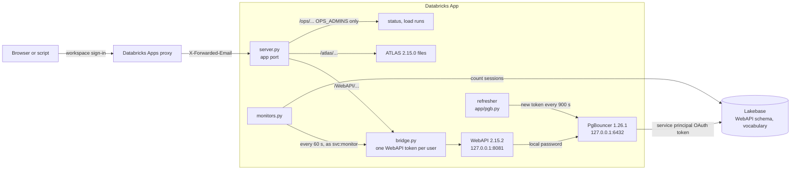
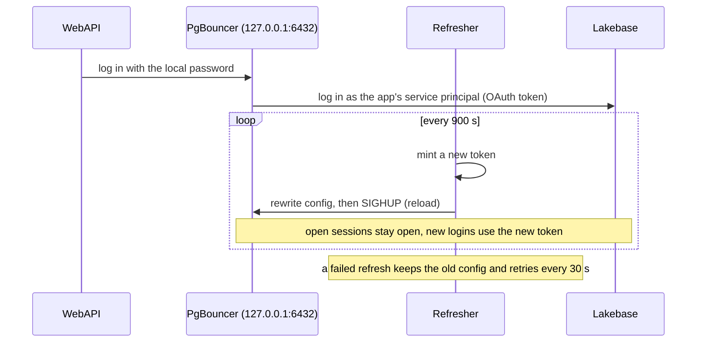
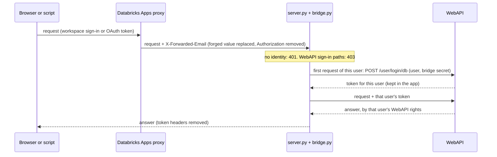
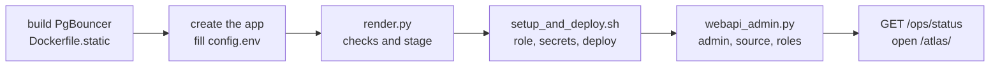

# OHDSI WebAPI on Lakebase, as a Databricks App

This repo runs OHDSI WebAPI 2.15.2 and the ATLAS 2.15.0 web app as one Databricks App. WebAPI keeps its own tables and reads an OMOP vocabulary in
Lakebase, the managed Postgres in Databricks. It logs in as the app's service principal (the app's Databricks
identity), so no database password is stored. The only password is a local one between WebAPI and PgBouncer, inside
the app. Users sign in with workspace single sign-on through the Databricks Apps proxy, and WebAPI security is on:
each user gets only the WebAPI rights an admin granted. ATLAS is at `<app url>/atlas/` and signs users in the same
way.



How the database login works: WebAPI connects to PgBouncer 1.26.1, a connection pooler, on 127.0.0.1:6432 inside the
app. WebAPI knows only a local PgBouncer password. PgBouncer logs in to Lakebase with an OAuth token for the app's
service principal. A small refresher (`app/pgb.py`) mints a new token every 900 seconds, rewrites PgBouncer's config
and sends a reload. Open sessions stay open, and new logins use the new token. WebAPI itself is unchanged.



## Security

The Databricks Apps proxy signs every user in (workspace single sign-on, or an OAuth token for scripts) and refuses
anyone without CAN USE on the app. It passes the user's identity to the app in `X-Forwarded-Email`, replaces any value
a client sends in that header, and removes `Authorization`. So WebAPI's own token cannot travel from the browser.

`app/bridge.py` connects the two. For each request, the front server reads the user from `X-Forwarded-Email` (a
service principal arrives as its application id). The bridge logs that user in to WebAPI's database login
(`/WebAPI/user/login/db`) with a bridge secret that only the app holds, keeps WebAPI's token per user, and sends it to
WebAPI. WebAPI then applies its own roles and per-source rights to that user.



How `app/server.py` answers one request (`do_GET`, `_gate`, `_atlas`, `_forward`):

```text
request
  path is ambiguous after one decode           -> 400
  /atlas...
    no proxy identity                          -> 401
    ATLAS download failed                      -> 503 + reason
    /atlas                                     -> 302 /atlas/
    file not inside the ATLAS folder           -> 404
    else                                       -> 200 (index.html, config-local.js: no-cache)
  /ops...
    identity not in OPS_ADMINS                 -> 404
    /ops/run|rotate|terminate, OPS_CONTROL off -> 404
    else                                       -> status or control
  everything else (/WebAPI/...)
    WebAPI sign-in path (/user/login ...)      -> 403
    no proxy identity                          -> 401
    else: bridge adds that user's WebAPI token -> WebAPI -> answer, token headers removed
```

What the code enforces (each item has an offline test, see Tests):

- A request without a proxy identity gets 401 and never reaches WebAPI.
- WebAPI's own sign-in paths (`/user/login`, `/user/runas`, `/user/oauth`, `/user/saml`, `/user/cas`,
  `/user/logout`) get 403 from outside, in every spelling the tests try (case, trailing `/`, `%2F`, double encoding,
  `;`, `//`, `/./`, `/../`). A path that is ambiguous after one decode gets 400.
- A client's `Authorization` header is always replaced. Each user has their own WebAPI token. After a WebAPI 401 the
  bridge logs in one more time, never in a loop.
- `/user/refresh` (ATLAS calls it after each 403) is done by the bridge for the signed-in user: it sends that user's
  token, keeps the new token WebAPI returns, and passes on only the body (the user's rights). After a 401 it logs in
  once more and tries once more, never in a loop. Every spelling of the path reaches this handler.
- `/atlas/...` needs a proxy identity (401 without one), gets the same path checks (400 for an ambiguous path), and
  serves only files inside the ATLAS folder after symlinks are followed (404 for anything else).
- WebAPI's token and cookie headers are removed from every answer. The bridge secret is in no log line and no answer.
- `/ops/*` answers only the identities in `OPS_ADMINS` (404 for everyone else). The controls (`/ops/run`,
  `/ops/rotate`, `/ops/terminate`) also need `OPS_CONTROL=on`.
- The in-app ticker and load runner log in as `svc:monitor`, a name no proxy identity can have.
- The launcher refuses to start unless `SECURITY_PROVIDER=AtlasRegularSecurity`, only the database login is on, and
  global read rights for new users are off. At each start it makes a new bcrypt hash of the bridge secret (WebAPI's
  database-login query returns that hash for any user name) and keeps the raw secret out of Java's environment.

WebAPI rules you meet once (read from the pinned image's migrations, then checked live):

- The first admin is set by SQL. After that, admins grant roles by REST.
- An admin has no rights on a new source. WebAPI makes a role `Source user (<key>)` for each source; add users to it.
- An admin can create roles and add users to roles by REST (`PUT /WebAPI/role/{roleId}/users/{userId}`), but can add
  rights by REST only to the public role. So a narrow role gets its rights by SQL (`tools/webapi_admin.py role-perm`).
- WebAPI's `admin` role cannot create concept sets. WebAPI's built-in role `Atlas users` holds the rights to create
  them; without it, ATLAS shows the name box as read-only and WebAPI answers 403. Add each ATLAS user to it.
- Workspace groups are not mapped to WebAPI roles. A user appears in WebAPI after their first request.

## ATLAS

The launcher downloads ATLAS 2.15.0 from the `ohdsi/atlas` image on Docker Hub, pinned by index digest, with the
manifest and every layer checked by SHA-256, the same way as WebAPI. It takes only the ATLAS folder from the layers
and refuses a layer entry that would land outside it. Then it replaces the image's `js/config-local.js` with its own
(`ATLAS_CONFIG` in `app/launcher.py`):

- WebAPI is this app's `/WebAPI/`, on the app's own address.
- Sign-in is on, with no login providers. ATLAS asks `/WebAPI/user/me`, and the bridge answers as the user the proxy
  signed in. Users never see an ATLAS login form, and ATLAS shows only the actions that user's WebAPI rights allow.
- The front server sends `index.html` and `config-local.js` with `Cache-Control: no-cache`, so a browser gets a new
  config after each deploy.

If the ATLAS download fails, WebAPI still starts, `/atlas/` answers 503 with the reason, and the launcher logs an
`atlas_error` event in `/ops/status`.

## A CDM in Delta

WebAPI can also read your OMOP CDM where it already is: in Delta tables, through a Databricks SQL warehouse. Nothing
is copied into Lakebase for this. The launcher downloads Databricks JDBC 2.6.36 from Databricks' public driver
bucket, `databricks-bi-artifacts.s3.us-east-2.amazonaws.com`, on every start, checks the zip and the one jar it reads by SHA-256, and puts the jar in WebAPI's `WEB-INF/lib`. A wrong file
stops the launcher before Java starts.

`tools/webapi_admin.py source-add-cdm` adds the source by REST, as an admin. The JDBC URL holds no login (`AuthMech=3`):
a login in the URL would win over WebAPI's username and password fields, and WebAPI stores only those two encrypted.
The username is `token`; the password is a token for the app's service principal, read from `CDM_TOKEN_FILE`. The
source has 4 daimons (CDM, Vocabulary, Results, Temp). Its Vocabulary priority is 0, so `SOURCE_KEY` on Lakebase stays
the default vocabulary.

Before the call (as a workspace admin):

1. Give the app's service principal, in Unity Catalog: `USE CATALOG`; `USE SCHEMA` and `SELECT` on the CDM and
   vocabulary schemas; `USE SCHEMA`, `SELECT` and `MODIFY` on the results schema; `USE SCHEMA`, `CREATE TABLE` and
   `MODIFY` on the scratch schema. The results schema holds the tables of WebAPI's results DDL
   (`/WebAPI/ddl/results?dialect=spark`).
2. Give it `CAN USE` on the SQL warehouse.
3. Make a token for it (`databricks token-management create-obo-token <application id> --lifetime-seconds <s>`), and
   save it to a file you own with mode 0600, outside this repo. `source-add-cdm` refuses any other file.
4. Fill in the `CDM_*` keys of `config.env`, then run `python3 -I tools/webapi_admin.py source-add-cdm`, and add users
   to `Source user (<CDM_SOURCE_KEY>)`.

The token ends at its lifetime. Then make a new one and change the source's password in WebAPI.

## What the app downloads

On every start, the launcher downloads four pinned artifacts through `app/artifacts.py`. A SHA-256 in the code fixes
each one, and the launcher checks every byte before it writes the byte to disk.

| Artifact | From | Hosts the download contacts |
|---|---|---|
| Temurin 8u492-b09 JRE | GitHub release | `github.com`, `release-assets.githubusercontent.com` |
| WebAPI 2.15.2 files | `ohdsi/webapi` image on Docker Hub | `auth.docker.io`, `registry-1.docker.io`, `production.cloudfront.docker.com` |
| ATLAS 2.15.0 files | `ohdsi/atlas` image on Docker Hub | the same 3 Docker Hub hosts |
| Databricks JDBC 2.6.36 | Databricks' driver bucket | `databricks-bi-artifacts.s3.us-east-2.amazonaws.com` |

If you limit the app's outbound network, allow these 6 hosts. `release-assets.githubusercontent.com` and
`production.cloudfront.docker.com` are redirect targets: GitHub and Docker Hub send the files from there, and they can
change these hosts. The launcher logs each host it contacts as a `host` event in `/ops/status`, with `known: false`
for a host that is not in this table. It does not refuse that host, so a blocked new host shows in the events.

The downloads write files only in their own folders and never through a symlink. They skip the symlinks and hard
links in the archives and log each one as a `link_skipped` event (the JRE has 2).

## How the code is laid out

```text
webapi-on-lakebase/
├── app/                         # runs inside the Databricks App
│   ├── launcher.py              # entry point: gets Java, WebAPI and ATLAS, starts PgBouncer, checks security, WebAPI
│   ├── artifacts.py             # the pinned downloads (JRE, WebAPI, ATLAS, JDBC driver), each checked by SHA-256
│   ├── pgb.py                   # PgBouncer process and the token refresher
│   ├── bridge.py                # proxy identity -> WebAPI login, and the request gate
│   ├── server.py                # front server on the app port: /WebAPI/... (through the bridge), /atlas/..., /ops/...
│   ├── monitors.py              # every 60 s: checks WebAPI, counts Lakebase sessions
│   ├── app.yaml.template        # app settings, with __PLACEHOLDERS__
│   └── requirements.txt
├── pgbouncer/Dockerfile.static  # builds PgBouncer 1.26.1 as one static binary
├── tools/                       # runs on your laptop
│   ├── render.py                # checks config, security settings and binary hash, stages the app outside the repo
│   ├── setup_and_deploy.sh      # Postgres role and grants, 3 secrets, then deploy.sh
│   ├── deploy.sh                # upload and deploy, committed code only (also for a new version)
│   ├── check.sh                 # runs every offline test
│   ├── webapi_admin.py          # first admin, the vocabulary source, roles, checks
│   └── teardown.sh              # removes what setup made, then checks
├── tests/                       # offline: test_app, test_bridge, test_render, test_atlas, test_artifacts, test_cdm_source
├── .github/workflows/check.yml  # runs tools/check.sh on each push
└── config.env.example           # your settings
```

What happens when the app starts (`app/launcher.py`, `main`):

```text
main
  fetch_jre                  # artifacts.fetch("jre"): Temurin 8 JRE, SHA-256 checked
  fetch_webapi               # artifacts.fetch("webapi"): image from Docker Hub, manifest and every layer checked by digest
  fetch_jdbc                 # artifacts.fetch("jdbc"): the driver jar into WEB-INF/lib; a wrong file stops the start
  fetch_atlas                # artifacts.fetch("atlas"), then the generated config-local.js; on error: None
  start_pgbouncer            # APP_DB=pgbouncer
    check the binary's SHA-256 against PGB_SHA256   # refuses to start if unset or different
    PgBouncer.start
      mint a token, write pgbouncer.ini and the userlist (0600)
      run PgBouncer on 127.0.0.1:6432, wait until it listens
      start the refresher loop
  security                   # APP_BRIDGE=on: refuses any other security setting
    bridge_env               # new bcrypt hash of BRIDGE_SECRET -> WebAPI's database-login query; secret removed
  start WebAPI               # Java on 127.0.0.1:8081, local password, URL 127.0.0.1:6432/webapi
  Monitors.start             # ticker and session sampler, every 60 s, through the bridge
  server.serve               # app port: /WebAPI through the bridge, /atlas, /ops for OPS_ADMINS
```

## What was tested, and what this copy is

The tested build ran in one Databricks workspace, on a Lakebase project with autoscaling 1-8 CU.

With WebAPI security off (the earlier runs):

- First start on an empty schema: Flyway created WebAPI's schema and ran its migrations (202 rows in
  `schema_history`, 0 failed). WebAPI was ready 58.0 s after the launcher started.
- Load: 1, 8 and 32 users, each with a 30 s warm-up and 180 s measured, and one forced token change per level.
  3,360 samples, every response HTTP 200, 0 client errors. A first run failed its pass rule with 1 client error:
  the first search on a vocabulary that no search had used before hit the load client's 120 s timeout.
- A simulated 3-day connection close: the service principal ended its own 57 Lakebase sessions at once. Every
  response stayed HTTP 200; the next full click path started 0.33 s later, with no restart. The real close at
  Lakebase's 3-day maximum connection life may look different.
- 6 hours with no load: 360 of 360 one-minute checks HTTP 200, 24 timer token changes, 0 refresh errors, and 0
  login-failed or JWT (token format) lines in PgBouncer's log.
- Stop and start of the app: token, then PgBouncer, then Java, in that order. Flyway added 0 rows, and WebAPI
  started in 23.956 s.
- The local PgBouncer password was in 0 of 259 saved logs and responses.

With WebAPI security on (this design, deployed again on an empty schema):

- Flyway: 202 rows, 202 succeeded. WebAPI was ready 53.8 s after the launcher started.
- Through the proxy, WebAPI saw the signed-in user's email. Forged `X-Forwarded-Email` and `X-Forwarded-User` headers
  from the client changed nothing.
- A second identity (a service principal given CAN USE on the app) arrived as its application id. It got 403 on the
  vocabulary source until an admin added it to the source's role, then 200.
- 8 WebAPI sign-in paths, among them `/user/Login/db` and `/user%2Flogin/db`, got 403 through the app. 4 `/ops`
  paths got 404 for an identity that is not in `OPS_ADMINS`.
- Stop and start: the next requests got 200 with no manual step. Roles and the source were kept, Flyway added 0
  rows, and WebAPI was ready after 148.0 s.
- 34 one-minute checks over 33.0 minutes, through the bridge as `svc:monitor`: all HTTP 200, 3 timer token changes,
  0 refresh errors.
- 0 tokens, 0 copies of the local password and 0 bridge secret values in 476 saved files and in the app log.
- Offline: 39 checks against a fake WebAPI pass, and 37 of 37 deliberate code breaks each made a check fail. WebAPI's
  own BCrypt (spring-security-crypto 4.2.3) accepts the launcher's `$2a$` hash and refuses a `$2b$` hash.

The tested build used the test project's own names. This copy replaces them with settings in `config.env`, renames
the operations path to `/ops`, and drops a search plug-in that is not part of this repo. It also drops the SQL tools
for adding a source: with security on, `tools/webapi_admin.py source-add` uses WebAPI's REST path, which also makes
the source's role. The load runner's third step is `ancestorAndDescendant`, because WebAPI's per-source role has no
right for `/descendants`. That was checked live once, for a service principal in the source's role:
`ancestorAndDescendant` 200, `descendants` 403.

This copy, deployed as committed to a new app on the same Lakebase project (autoscaling 1-8 CU), with
`config.env` filled in and no code changed:

- `render.py` and `setup_and_deploy.sh` worked as written. Flyway: 202 rows, 202 succeeded.
- The 8 calls of step 5 below (all but `Atlas users`) worked in that order, plus `role-add "Source user (<SOURCE_KEY>)" svc:monitor`.
  `forged` printed the signed-in user's login twice. 8 WebAPI sign-in paths got 403 through the app.
- Load with security on: 1, 8 and 32 users, each with a 30 s warm-up and 180 s measured, one forced token change per
  level, click path search, concept, `ancestorAndDescendant`, all through the bridge. 2,898 samples, every response
  HTTP 200, 0 client errors, 0 bridge login failures, 0 PgBouncer login-failed or JWT lines. Click paths per second:
  2.26 at 8 users and 2.19 at 32 users (security off: 2.24 and 2.14). At 1 user: 0.36 (security off: 1.16),
  because some first searches were still cold (slowest 33.2 s). Before that run, one 60 s warm-up at 1 user
  (not measured) had 1 client timeout on the first search of a cold vocabulary.
- 0 tokens and 0 copies of the local password in the saved results and in the app log (468 lines).

ATLAS, in the same app, deployed with `tools/deploy.sh` (it printed that the uploaded files match the commit):

- The launcher fetched ATLAS from the pinned image (24,393 files) with no `atlas_error`. WebAPI was ready in 28.7 s.
- `/atlas/js/config-local.js` was byte for byte the committed config, sent with `no-cache`.
- In Chrome, signed in through the proxy: ATLAS showed the user's email and no login form. A search for `diabetes`
  gave 50 rows, concept 201826 (`Type 2 diabetes mellitus`) opened with its hierarchy, and a saved concept set was
  in WebAPI's schema afterwards. The first try of the save got 403 until the user was in `Atlas users` (step 5).
- `/user/refresh` through the proxy: 200, no token in the answer, and the next request worked with no new login.
- With no sign-in, `/atlas/` and `/WebAPI/info` got only the proxy's redirect to the workspace sign-in.
- Browser console: 0 failed `/WebAPI/` calls. 3 errors with 404: `js/config-gis.js` (ATLAS loads it only if it
  exists) and 2 record-count calls (record counts need a source with a results schema; the test source had the
  vocabulary only).
- 0 tokens, 0 copies of the local password and 0 bcrypt hashes in the saved results and in the app log (202 lines).
- Offline: 5 test files pass, and 94 of 94 deliberate code breaks each made a check fail.

A CDM in Delta, in the same app (the CMS DE-SynPUF 100k extract, 100,000 synthetic persons; one SQL warehouse; security on):

- The launcher logged the JDBC jar with its pinned SHA-256. `source-add-cdm` answered 200. Through the proxy and the
  bridge, the CDM source gave its vocabulary version, and concept 201826 was `Type 2 diabetes mellitus`.
- WebAPI's stored source: no token in the URL, username and password both encrypted (`ENC(...)`).
- The same requests on the Lakebase source and the CDM source (concept, related, `ancestorAndDescendant` for 11
  concepts; 5 searches): 38 of 38 had the same content, in any order. On the first run, one `related` request on the
  CDM source answered 500: the JDBC driver's socket timeout while it waited for the warehouse. The same request
  right after answered 200. The second run, from the start, had 0 errors. The cause was not found.
- A cohort (type 2 diabetes, first condition per person) generated on the CDM source through the app: COMPLETE in
  52 s, 67,365 persons, equal to an independent SQL count and to the rows in the results `cohort` table.
- A second identity got 403 on the CDM source until it was in `Source user (<CDM_SOURCE_KEY>)`, then 200. An
  admin sees the password field masked.
- 0 copies of the token in 163 saved files and in the app log.

## What was not tested

- ATLAS with more than one user at the same time, and ATLAS features that need a results schema (record counts,
  cohort generation, characterizations).
- A long run (hours) with security on, a simulated connection close with security on, and more than 32 users.
- Changing the bridge secret while users are signed in.
- A real close at the 3-day maximum connection life (only simulated, above).
- Rotation of the app service principal's own credentials.
- Load on a CDM source, and a longer JDBC `SocketTimeout`.
- Token rotation for a CDM source.
- Downloads staged in a Unity Catalog volume. The launcher fetches the JRE, the WebAPI image, the ATLAS image and
  the JDBC driver from the internet.

## Why PgBouncer 1.26.1 or later

PgBouncer 1.25 caps passwords at 2,048 characters and cuts longer ones. A Lakebase OAuth token is about 2,250
characters, so the cut token is no longer valid and the login fails. PgBouncer 1.26.0 raised the cap. 1.26.1 also
fixes CVE-2026-107350: versions 1.17.0 through 1.26.0 processed a second StartupMessage sent during SCRAM login,
and this setup uses `auth_type = scram-sha-256`.

## What you need

- A Databricks workspace with Databricks Apps, a Lakebase project, and the Databricks CLI logged in to a profile.
- Your OMOP vocabulary tables or views in one schema on that Lakebase project.
- You are the Lakebase project owner. The scripts log in as you to create the app's role and grants, and to set the
  first WebAPI admin.
- `psql`, Python 3 with `psycopg[binary]` (for `webapi_admin.py grant` and `role-perm`), Docker (to build
  PgBouncer), and `uv` to run the tests.

## Steps



1. Build PgBouncer as one static linux/amd64 binary. The build checks the source tarball's published SHA-256.

   ```
   docker buildx build --platform linux/amd64 -f pgbouncer/Dockerfile.static --output type=local,dest=build pgbouncer
   shasum -a 256 build/pgbouncer-1.26.1-linux-amd64-static
   ```

2. Create the app: `databricks apps create <app name> --profile <profile>`. This starts the app compute, which is
   billable, and can take more than 2 minutes.

3. Copy `config.env.example` to `config.env` and fill it in. `PGB_SHA256` is the hash of the binary you built in
   step 1. `APP_URL` is the app's URL (`databricks apps get <app name> -o json`). Put your email in `OPS_ADMINS`.
   git ignores `config.env`.

4. Render and deploy. `tools/render.py` stages the app in `~/.webapi-on-lakebase/stage`, checks the binary's hash,
   and refuses a template where security is not on. `tools/setup_and_deploy.sh` creates the service principal's
   Postgres role and grants and the three app secrets, then deploys. It makes a new bridge secret on each run, and no
   copy stays on your machine. Read it first.

   ```
   python3 -I tools/render.py
   bash tools/setup_and_deploy.sh
   ```

5. Set up WebAPI's rights, in this order. Each line is one call. Your WebAPI user appears with your first request.

   ```
   python3 -I tools/webapi_admin.py me                                   # your login; makes your WebAPI user
   python3 -I tools/webapi_admin.py grant <your email> admin             # the first admin (SQL)
   python3 -I tools/webapi_admin.py source-add                           # source SOURCE_KEY on VOCAB_SCHEMA
   python3 -I tools/webapi_admin.py role-add "Source user (<SOURCE_KEY>)" <your email>
   python3 -I tools/webapi_admin.py role-add "Atlas users" <your email>  # ATLAS create rights (concept sets)
   python3 -I tools/webapi_admin.py role-create Monitor                  # a narrow role for the in-app ticker
   python3 -I tools/webapi_admin.py role-perm Monitor conceptset:get
   python3 -I tools/webapi_admin.py role-add Monitor svc:monitor
   python3 -I tools/webapi_admin.py forged                               # must print your login, not the forged one
   ```

   If you set `TICK_CONCEPT_ID` or use the load runner, also add `svc:monitor` to the source's role:
   `role-add "Source user (<SOURCE_KEY>)" svc:monitor`. For each other user: they open the app once, then you add
   them to the roles they need, for example `role-add "Source user (<SOURCE_KEY>)" <their email>` and
   `role-add "Atlas users" <their email>`.

6. Check `GET <app url>/ops/status`: the launcher events (downloads and their hosts, token, PgBouncer listening, bridge, Java start),
   `cold_done` and the bridge's login counts. `GET <app url>/ops/conn` shows the refresher, the in-app checks every
   60 s, and the Lakebase session counts. The in-app load runner needs your own `queries.json` (set `QUERIES_JSON`)
   and `OPS_CONTROL=on`; without them `/ops/run` answers 404. Then open `<app url>/atlas/`.

7. To deploy a new version later (no schema, secret or resource change): commit, then
   `python3 -I tools/render.py && bash tools/deploy.sh`. It stops if a staged app file differs from the commit.

## Tests

```
bash tools/check.sh
```

It runs the 6 test files in `tests/` with pinned test packages (through `uv`), and checks the shell scripts. CI runs it
on each push. All tests run offline, with no Databricks, Lakebase or Java. `tests/test_bridge.py` runs the real front server and
bridge against a fake WebAPI, with checks for each item of the security list above. `tests/test_atlas.py` runs the
front server on a fake ATLAS tree with hostile files (a config that turns sign-in off, symlinks out of the tree), and
`tests/test_artifacts.py` feeds the four downloads hostile archives (`..`, absolute paths, whiteouts, symlinks, wrong
digests), hostile redirects, and checks that this README names every known host. `tests/test_cdm_source.py` feeds
`source-add-cdm` logins smuggled into the URL and token files that others can read.

## Teardown

Stop the app, then run `bash tools/teardown.sh`. It removes WebAPI's schema, the service principal's Postgres role,
the app and its service principal, the secret scope (with the bridge secret), the app's workspace folder and the
local PgBouncer password file, then checks each one.

## License

Apache License 2.0. See `LICENSE`.

I work at Databricks. All opinions are my own.
