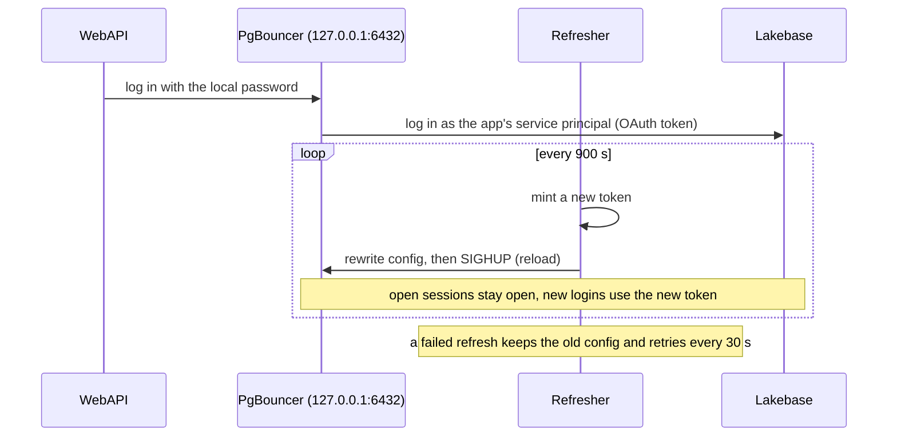
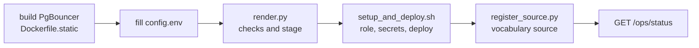

# OHDSI WebAPI on Lakebase, as a Databricks App

This repo runs OHDSI WebAPI 2.15.2 as a Databricks App. WebAPI keeps its own database on Lakebase, the managed
Postgres in Databricks, and reads an OMOP vocabulary from Lakebase. The app logs in to Lakebase as its own service
principal (the app's Databricks identity). No Lakebase password is stored anywhere: the only password is a local one
between WebAPI and PgBouncer, inside the app.

How the login works: WebAPI connects to PgBouncer 1.26.1, a connection pooler, on 127.0.0.1:6432 inside the app.
WebAPI knows only a local PgBouncer password. PgBouncer logs in to Lakebase with an OAuth token for the app's
service principal. A small refresher (`app/pgb.py`) mints a new token every 900 seconds, rewrites PgBouncer's config
and sends a reload. Open sessions stay open, and new logins use the new token. WebAPI itself is unchanged.



## How the code is laid out

```text
webapi-on-lakebase/
├── app/                         # runs inside the Databricks App
│   ├── launcher.py              # entry point: gets Java and WebAPI, starts PgBouncer, starts WebAPI
│   ├── pgb.py                   # PgBouncer process and the token refresher
│   ├── server.py                # front server on the app port: /WebAPI/... and /ops/...
│   ├── monitors.py              # every 60 s: checks WebAPI, counts Lakebase sessions
│   ├── app.yaml.template        # app settings, with __PLACEHOLDERS__
│   └── requirements.txt
├── pgbouncer/Dockerfile.static  # builds PgBouncer 1.26.1 as one static binary
├── tools/                       # runs on your laptop
│   ├── render.py                # checks config and binary hash, stages the app outside the repo
│   ├── setup_and_deploy.sh      # Postgres role and grants, 2 secrets, upload, deploy
│   ├── register_source.py       # adds the vocabulary as a WebAPI source (login stored encrypted)
│   ├── EncryptForWebApi.java    # encrypts that login the way WebAPI does
│   └── teardown.sh              # removes what setup made, then checks
├── tests/                       # offline: test_app.py, test_render.py
└── config.env.example           # your settings
```

What happens when the app starts (`app/launcher.py`, `main`):

```text
main
  fetch_jre                  # Temurin 8 JRE, SHA-256 checked
  fetch_webapi               # WebAPI 2.15.2 image from Docker Hub, manifest and every layer checked by digest
  start_pgbouncer            # APP_DB=pgbouncer
    check the binary's SHA-256 against PGB_SHA256   # refuses to start if unset or different
    PgBouncer.start
      mint a token, write pgbouncer.ini and the userlist (0600)
      run PgBouncer on 127.0.0.1:6432, wait until it listens
      start the refresher loop
  start WebAPI               # Java on 127.0.0.1:8081, local password, URL 127.0.0.1:6432/webapi
  Monitors.start             # ticker and session sampler, every 60 s
  server.serve               # app port: forwards /WebAPI, serves /ops
```

## What was tested, and what this copy is

The tested build ran in one Databricks workspace, on a Lakebase project with autoscaling 1-8 CU. Results of that build, in short:

- First start on an empty schema: Flyway created WebAPI's schema and ran its migrations (202 rows in
  `schema_history`, 0 failed). WebAPI was ready 58.0 s after the launcher started.
- Load: 1, 8 and 32 users, each with a 30 s warm-up and 180 s measured, and one forced token change per level.
  3,360 samples, every response HTTP 200, 0 client errors. A first run failed its pass rule with 1 client error:
  the first search on a vocabulary that no search had used before hit the load client's 120 s timeout.
- A simulated 3-day connection close: the service principal ended its own 57 Lakebase sessions at once. Every
  response stayed HTTP 200; the next full click path started 0.33 s later, with no restart. The real close at
  Lakebase's 3-day maximum connection life may look different.
- 6 hours with no load: 360 of 360 one-minute checks HTTP 200, 24 timer token changes, 0 refresh errors, and 0
  login-failed or JWT (token format) lines in PgBouncer's log.
- Stop and start of the app: token, then PgBouncer, then Java, in that order. Flyway added 0 rows, and WebAPI
  started in 23.956 s.
- The local PgBouncer password was in 0 of 259 saved logs and responses.

The tested build used the test project's own names. This copy replaces them with settings in `config.env`, renames
the operations path to `/ops`, and drops a search plug-in that is not part of this repo. This copy was checked
offline only: the Python compiles, the shell scripts pass `bash -n`, and the tests in `tests/` pass. It has not been
deployed since those changes.

## What was not tested

- WebAPI with security on. The tested build ran with `SECURITY_PROVIDER=DisabledSecurity`.
- The ATLAS web app, and browser clicks through the Databricks Apps proxy. The load ran on 127.0.0.1 inside the app.
- A real close at the 3-day maximum connection life (only simulated, above).
- Rotation of the app service principal's own credentials.
- Downloads staged in a Unity Catalog volume. The launcher fetches the JRE and the WebAPI image from the internet.

## Why PgBouncer 1.26.1 or later

PgBouncer 1.25 caps passwords at 2,048 characters and cuts longer ones. A Lakebase OAuth token is about 2,250
characters, so the cut token is no longer valid and the login fails. PgBouncer 1.26.0 raised the cap. 1.26.1 also
fixes CVE-2026-107350: versions 1.17.0 through 1.26.0 processed a second StartupMessage sent during SCRAM login,
and this setup uses `auth_type = scram-sha-256`.

## What you need

- A Databricks workspace with Databricks Apps, a Lakebase project, and the Databricks CLI logged in to a profile.
- Your OMOP vocabulary tables or views in one schema on that Lakebase project.
- You are the Lakebase project owner (the scripts log in as you to create the app's role and grants).
- `psql`, Python 3, and Docker (to build PgBouncer and to encrypt the source credentials).

## Steps



1. Build PgBouncer as one static linux/amd64 binary. The build checks the source tarball's published SHA-256.

   ```
   docker buildx build --platform linux/amd64 -f pgbouncer/Dockerfile.static --output type=local,dest=build pgbouncer
   shasum -a 256 build/pgbouncer-1.26.1-linux-amd64-static
   ```

2. Create the app: `databricks apps create <app name> --profile <profile>`.

3. Copy `config.env.example` to `config.env` and fill it in. `PGB_SHA256` is the hash of the binary you built in
   step 1. git ignores `config.env`.

4. Render and deploy. `tools/render.py` stages the app in `~/.webapi-on-lakebase/stage` and checks the binary's
   hash. `tools/setup_and_deploy.sh` creates the service principal's Postgres role and grants, the two app secrets,
   and deploys. Read it first: it starts the app compute, which is billable.

   ```
   python3 -I tools/render.py
   bash tools/setup_and_deploy.sh
   ```

5. Register the vocabulary as a WebAPI source, through PgBouncer's `vocab` pool, with the local password:

   ```
   set -a; . ./config.env; set +a
   python3 -I tools/register_source.py "$SOURCE_KEY" "Vocabulary" postgresql \
     "jdbc:postgresql://127.0.0.1:6432/vocab?sslmode=disable&ApplicationName=webapi-pgb-vocab" webapi ~/.webapi-on-lakebase/secrets/pgb_local_pass \
     "[[\"Vocabulary\",\"$VOCAB_SCHEMA\",1]]"
   ```

   Then call `GET <app url>/WebAPI/source/refresh`.

6. Check `GET <app url>/ops/status`: the launcher events (token, PgBouncer listening, Java start) and `cold_done`.
   `GET <app url>/ops/conn` shows the refresher, the in-app checks every 60 s, and the Lakebase session counts.
   The in-app load runner needs your own `queries.json` (set `QUERIES_JSON`); without it `/ops/run` answers 404.

## Tests

```
python3 -I tests/test_app.py
python3 -I tests/test_render.py
```

Both run offline, with no Databricks, Lakebase or Java.

## Teardown

Stop the app, then run `bash tools/teardown.sh`. It removes WebAPI's schema, the service principal's Postgres role,
the app and its service principal, the secret scope, the app's workspace folder and the local PgBouncer password
file, then checks each one.

## License

Apache License 2.0. See `LICENSE`.

I work at Databricks. All opinions are my own.
